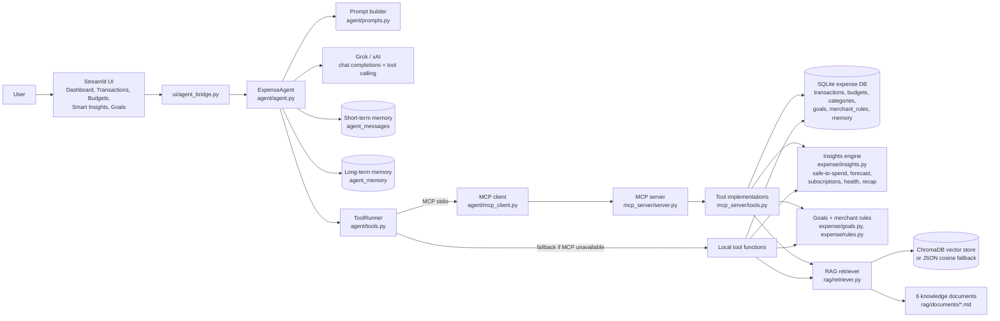

# Agent Architecture

## Turn-by-turn flow

1. **UI** sends the user message to `ExpenseAgent.ask()`.
2. **Short-term memory** (`agent_messages`) loads the last 14 turns for the
   current `session_id`.
3. **Long-term memory** (`agent_memory`) loads durable facts for the `user_id`.
   These are injected into the system prompt.
4. The **prompt builder** creates the role/scope/tool/evidence/memory/failure
   instructions (`agent/prompts.py`).
5. **Grok** receives the messages plus JSON tool schemas. If it chooses a tool,
   the agent executes it through the **MCP client → MCP server** and appends the
   tool result to the conversation. This repeats for up to 5 tool rounds.
6. If Grok is missing or fails, the **deterministic rule engine** uses the same
   `ToolRunner` and produces a grounded answer.
7. The assistant turn, tool names, sources, and transport (`mcp`/`local`) are
   saved. Rule-based fact extraction writes new durable memories.
8. The UI renders the answer, tool tags, sources, memory used, and MCP evidence.

## Memory model

| Store | Table | Lifetime | Purpose |
|---|---|---|---|
| Short-term | `agent_messages` | One `session_id` | Follow-up questions and pronoun resolution |
| Long-term | `agent_memory` | Until deleted | User preferences, goals, budgets, profile facts |
| Audit | `agent_tool_calls` | Permanent | Proof that tools ran and whether MCP was used |

RAG documents are **shared financial guidance**; long-term memory is
**user-specific context**. They are deliberately separate.

## Why MCP instead of a normal HTTP call?

Assignment 2 explicitly requires a functioning MCP client–server tool
interaction. `agent/mcp_client.py` launches `mcp_server/server.py` over the
stdio transport, performs the MCP `initialize` handshake, lists tools, and calls
`session.call_tool(...)`. A plain HTTP endpoint would not satisfy that
requirement.

## Windows native-import note

FastMCP executes synchronous tools in a worker thread. On Windows, importing
NumPy/SciPy/scikit-learn for the first time from that worker deadlocks while the
import lock is held, which made the RAG tool hang. `mcp_server/server.py`
preloads those libraries in `_warmup_embeddings()` on the main thread before
`mcp.run()`, so retrieval over MCP is reliable. This is a platform fix, not a
mock: the tool still runs through the real MCP protocol.
